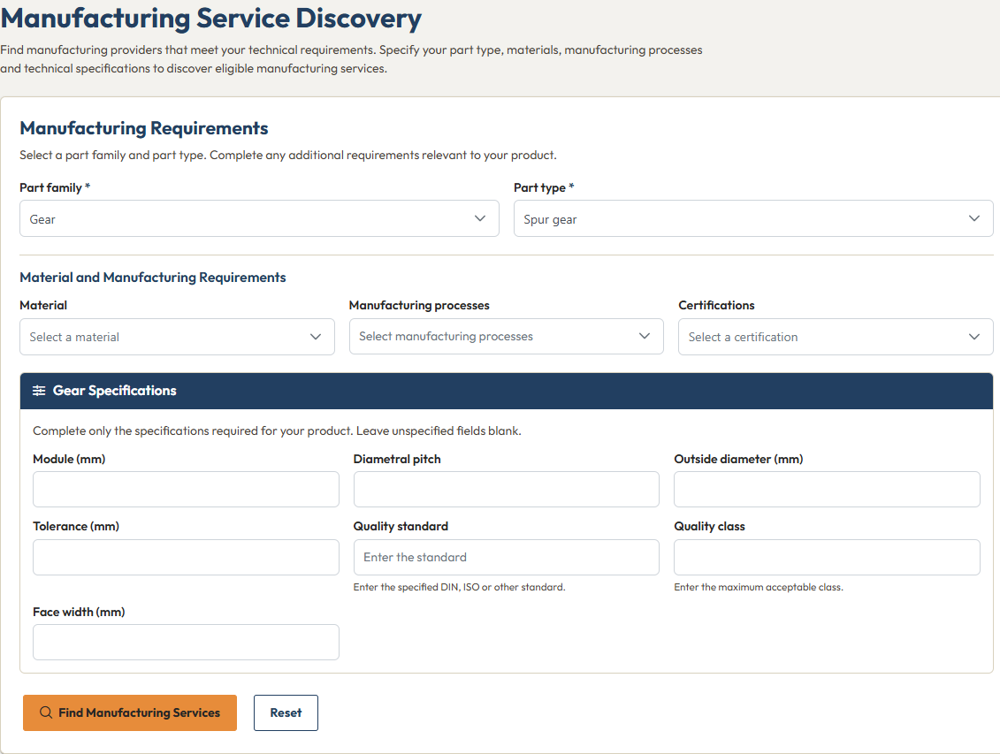
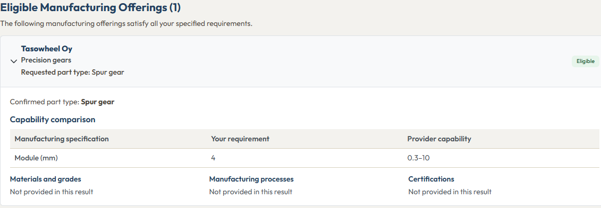

# Task 16A — Consumer UI consolidated refinement

- **Verification date** · 27 November 2026
- **Implementation** · `53c847b79763d4bf13665c6599d006a69db88863`
- **Local acceptance** · [Manufacturing Service Discovery](http://localhost:3000/demo/consumer-search)

## Before and after

The original Consumer screen showed editable identifiers, a free-text criterion the request did not use, a request preview, and expandable response diagnostics. The refined Manufacturing Service Discovery page leads with the required part family and type, then optional material, manufacturing processes, certifications, and applicable technical specifications. On desktop, the required selectors use two equal columns and both optional sections use three. They stack in one column at narrow widths. The search action uses MaaSAI orange and the specification header uses navy.

The form loads labels and values from `GET /api/catalog/filters`. Gear and Spur gear are the defaults when available. Otherwise it selects a valid combination from the returned options. Material and certification remain single-select and manufacturing processes remain multi-select. All three can be cleared. Reset restores the catalogue-derived default, clears optional criteria and feedback, and invalidates pending results. Editing any criterion also invalidates the old results.

The internal consumer identifier uses the existing signed-in Keycloak subject from the authentication context, with `consumer_service_discovery` as the neutral fallback when a subject is unavailable. Each valid submission generates a fresh UUID-based request ID and uses contract version 1.0. The browser checks the response's request and selection identifiers, count, unique offering identities, and full-match status before rendering. It preserves the backend's offering order and includes separate offerings from the same provider.

Each expandable result shows the provider, offering, requested part type and a single Eligible status. The expanded comparison presents the requested criterion alongside the returned provider value. Materials and available grades, manufacturing processes, and certifications come from returned evidence. The search response supplies evidence associated with the search, so the UI shows “Not provided in this result” for missing details. A search by part type alone shows the confirmed type and explains that no additional requirements were specified.

Dashboard, sidebar, role prompts and Provider and Admin descriptions use application terminology. The Provider Area states that registration and changes are available for designated test records only and gives the exact `mdc_stage1b_` prefix. The existing role and revision checks protect the same operations.

## Supported criteria

The frontend uses one definition for each visible specification field and its request mapping. It clears all technical fields when the family or type changes and keeps the selected material, processes and certification. Numeric fields use decimal or whole-number keyboards where supported, validate the entered value, and retain decimal precision within the API's number representation.

| Scope | Request mapping |
| --- | --- |
| All families | Selected material and certification each become a one-item generic requirements list. Manufacturing processes become a generic requirements list. |
| Gear | Family includes `module.exact`, equal `diametral_pitch.min` and `.max`, `outside_diameter_mm.max`, and `tolerance_mm.max`. Quality standard and maximum class become `gear_quality: {standard, max_class}`. Spur, helical, bevel and crown gears accept `face_width_mm.exact` in type specifications. |
| Shaft | Family includes `length_mm.max`, `outer_diameter_mm.max`, and `tolerance_mm.max`. Splined shafts accept `spline_module.exact`. Hollow shafts accept `inner_diameter_mm.max` and `wall_thickness_mm.exact`. |
| Block | Length, width and height become maximums under family `bounding_box_mm`. Type uses `number_of_holes.max`. Generic fields are weight, tolerance maximum and surface finish Ra maximum. |
| Plate | Block mapping with thickness as the bounding-box height. |
| Bracket | The family and generic mapping used by Block. Type uses maximum vertical and horizontal flange lengths. |
| Bushing | Family uses maximum inner and outer diameters, overall length and tolerance. Type uses `flange_diameter_mm.max`. Surface finish Ra maximum is generic. |
| Roller | The rotational diameter, length, and tolerance mapping used by Bushing, plus generic weight and surface finish Ra maximum. |
| Collar | The rotational diameter, length, and tolerance mapping used by Bushing, plus generic surface finish Ra maximum. |

The API accepts a named gear-quality standard and provides no controlled list of standards in the catalogue response. The standard stays a text field and the class is a positive number. Both fields are required when a quality requirement is entered. Hole counts must be positive whole numbers, so entering zero produces field validation. Face width is absent for worm gears because the contract does not support it for that type. The free-text technical requirements field was removed because it was never serialized. Material grades are available as returned evidence and the API has no separate grade search criterion. [Partner API documentation](../Partner_API/MaaSAI_MDC_API_Documentation.md)

## Verification

The signed-in Edge browser used the permanent local Next.js server on `127.0.0.1:3000` and the existing relay to the protected Task 14A Preview `dpl_FTCmjoE7jo7QtP1ayEe5JER7UCtC`. The only live application requests exercised were reads and service-discovery searches.

| Signed-in check | Observed result |
| --- | --- |
| Catalogue options and retry | Live GET returned HTTP 200. Blocking that request in the browser showed the unavailable message and disabled search. Unblocking and selecting Retry returned HTTP 200 and restored the form. |
| Spur gear, Module 4 | HTTP 200, one eligible offering from Tasowheel Oy. The request sent `module.exact = 4`. Expanded evidence showed a provider range of 0.3–10 mm. |
| Spur gear, Module 1 | HTTP 200, two eligible offerings from Precipart and Tasowheel Oy. Both Module searches used the signed-in subject with distinct request IDs and the strict match policy. |
| Crown gear and type-only search | Crown gear returned HTTP 200 and zero offerings with the agreed empty-state message. A Spur gear search with only the required selectors returned two offerings and showed the confirmed part type with the no-additional-requirements message on expansion. |
| Shaft | The Splined shaft form sent length 20.125 mm maximum, tolerance 0.0005625 mm maximum and exact spline module 2.125 and returned HTTP 200. Switching to Hollow shaft cleared the former values, kept the selected material and displayed only common fields and hollow geometry. |
| Metal parts | Checked the distinct rendered fields for Block, Plate, Bracket, Bushing, Roller and Collar. A Plate search sent 1.125 mm as maximum bounding-box height and 2 as maximum hole count, and returned HTTP 200. Zero holes and an incomplete gear-quality pair produced inline field validation before submission. |
| Criteria and recoverable errors | Cleared Steel, Machining and ISO 9001:2015 individually. Changing criteria cleared displayed results. With an actual HTTP 200 reply paused in the browser, Reset restored the default and the released reply did not repopulate results. A blocked search kept Module 1 in the form, and retry returned HTTP 200. |
| Layout and results | Verified the 2/3/3 desktop grid at 1440 px and a one-column form at 390 px without horizontal overflow. Signed-in views showed the specified labels, evidence and feedback without diagnostic panels or visible offering IDs. |
| Provider Area and Admin Dashboard | Both signed-in pages loaded Tasowheel over HTTP 200 and kept the baseline provider read-only. The Provider Area had no Delete provider action. Admin showed two available system checks, four catalogue metrics, and the reused read-only provider view. The protected provider had no Delete provider action. |

- **Focused regression tests** · 81 passed, with 63 existing tests and 18 new Consumer tests. The new tests cover all profile request mappings, request IDs, invalid input, selection and reset, strict response validation, evidence formatting, and visible copy.
- **Targeted ESLint** · Passed on all changed JavaScript files and the Consumer regression test, with zero warnings.
- **Production build** · Next.js 14.0.3 exited successfully from the committed frontend in a temporary directory, generated all 20 static pages, and produced `.next/standalone/server.js`. Existing warnings concern React Hook dependencies in the shared layout, the stylesheet tag in `_document.js`, and stale Browserslist data.

The optional filter outage and delayed response were browser-only test conditions. The permanent checkout retained the existing local edits, two stashes, environment files, dependencies, and logo asset. Task 16 session refresh and relay retargeting, and Task 17 hosted frontend deployment, remain deferred.

## Screenshots

Captured from the signed-in local interface. The screenshots show the application content below the account toolbar.

- [Crown gear empty state](assets/task16a-consumer-refinement/consumer-no-offerings.png)
- [Hollow shaft specifications](assets/task16a-consumer-refinement/consumer-shaft-specifications.png)
- [Bracket specifications](assets/task16a-consumer-refinement/consumer-metal-specifications.png)
- [Narrow 390 px form](assets/task16a-consumer-refinement/consumer-search-narrow.png)

## Conclusion

**PASS.** The consolidated Consumer refinement passed the signed-in checks, focused regression tests, targeted lint and production build. One local development server remains available on `127.0.0.1:3000`. The Dashboard, Consumer, Provider and Admin routes each returned HTTP 200 there.
