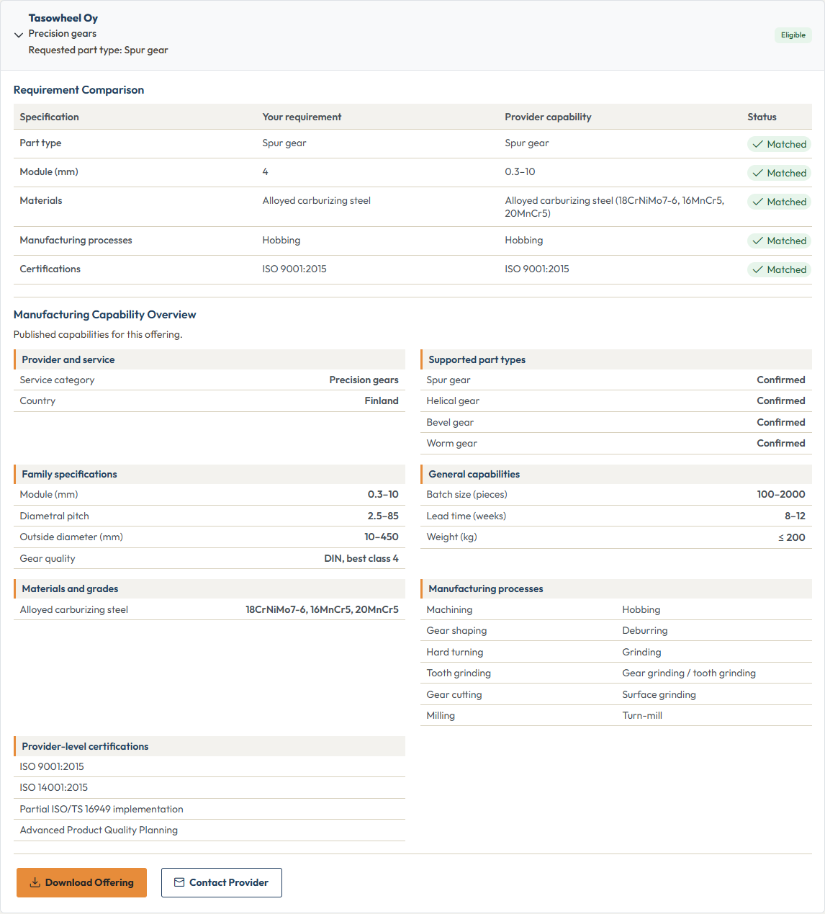

# Task 16B — Consumer offering details and actions

- **Verified** · 27 November 2026
- **Implementation** · `9dc2b19823f2a908f8ef0a857933c66582dabb59`
- **Local acceptance** · [Manufacturing Service Discovery](http://localhost:3000/demo/consumer-search)

## Expanded offering

**Requirement Comparison** uses the eligible search response for the confirmed part type and each matched requirement. It shows the consumer's criterion, the evidence returned by search, and a Matched status. Searches with only a part type include the confirmation row and “No additional requirements were specified.”

**Manufacturing Capability Overview** loads exact provider and offering records when a result opens. It shows published family, selected part-type and general specifications, support statuses, materials with grades grouped under their own material, processes with delivery modes where supplied, certifications with provider or offering scope, and published business details. These include the country, provider description, production mode and industries served where the API supplies them. Empty optional sections are omitted. A material with no published grades reads “Not published.”

**Download Offering** saves a PDF built from the same displayed facts and comparison. **Contact Provider** opens an informational PrimeReact toast for about four seconds with the agreed future-release message. The search form, its optional Reset, strict eligibility, offering-level result order, and ability to submit again after edits carry forward from Task 16A. [Task 16A report](16A_MDC_Consumer_UI_Consolidated_Refinement_Report.md)

## Exact reads and state

The local same-origin relay uses the existing `getOffering` and `getProvider` clients for `GET /api/offerings/{offering_id}` and `GET /api/providers/{provider_id}`. Only those two exact GET permissions gained the signed Consumer role. Provider and Admin keep their existing access. The provider offerings list, validation endpoint, and all writes keep their prior authorization. The relay continues to verify Keycloak, operate on loopback, use its server-only Preview access, preserve strong ETags, and return `Cache-Control: no-store`.

The Consumer view checks contract version, identities and ownership, names, family and category, active state, and confirmed support of the requested part type. It also checks that the retrieved values agree with comparable evidence from the search. It asks the consumer to search again when a record is missing, has changed, or conflicts with that evidence. Temporary errors preserve the original comparison and offer a per-result retry. Downloads are enabled once details are available.

A result uses its own detail state, and reopening it in the same search reuses the successful reads. A new search, changed criteria, or a role or session change discards that search's details. The overview and export select approved business and capability fields. They exclude publication metadata, arbitrary custom fields and source notes.

## PDF export

The only new direct dependency is MIT-licensed jsPDF `4.2.1`, pinned in the lockfile. Its published security fixes were reviewed. The PDF module and bundled DejaVu Sans 2.37 font load on demand. The browser uses the library's text and drawing APIs with a local licensed font, wraps long text, and repeats headers and page numbers as needed. Export uses the loaded result without another catalogue request. The local font supports the verified names, grades and engineering symbols. Export reports a character it cannot render. [jsPDF release](https://github.com/parallax/jsPDF/releases/tag/v4.2.1) · [DejaVu Sans release](https://github.com/dejavu-fonts/dejavu-fonts/releases/tag/version_2_37) · [Font license](../../demo-frontend/public/layout/fonts/offering-pdf/LICENSE.txt)

## Signed-in verification

The browser ran the Consumer view against the existing protected Task 14A Preview `dpl_FTCmjoE7jo7QtP1ayEe5JER7UCtC` through the permanent local relay. Live requests were catalogue and exact detail reads plus discovery searches. Consumer-only relay authorization was tested separately with signed role fixtures.

| Check | Observed evidence |
| --- | --- |
| Spur gear selection only | HTTP 200, two offerings. No detail requests occurred before expansion. The Tasowheel and Precipart expansions each fetched one exact provider and one exact offering with HTTP 200. Reopening Tasowheel reused its details. |
| Tasowheel Gear | Module 0.3–10 mm, outside diameter 10–450 mm, DIN best class 4, three alloyed carburizing steel grades, 12 processes and four provider certification entries were checked against the API and rendered overview. The API had no numeric surface finish maximum for this record. |
| Precipart Gear | Module 0.125–1.5 mm, outside diameter 6–102 mm, and Switzerland were displayed. Unpublished materials, processes and certifications were omitted. The Tasowheel values did not carry over. |
| Eligibility and search again | Module 4 returned Tasowheel only. Module 1 returned Tasowheel and Precipart. Crown gear returned HTTP 200 with zero offerings. The form also resubmitted identical criteria with a new request ID and accepted changed requirements without Reset. |
| Generic requirement comparison | The live Tasowheel Module 4, alloyed carburizing steel, Hobbing and ISO 9001:2015 search showed all four requirements and the confirmed Spur gear row, each with returned evidence. |
| Plain shaft | Length maximum 500 mm and outer diameter maximum 80 mm returned two eligible offerings. The Tasowheel Shaft expansion read its exact record and showed the matching dimensional evidence. |
| Roller | Steel and Turning returned one offering, the existing Demo Metal Works Oy record. It showed the published Roller outer diameter limit of 100 mm, separate Steel and Aluminum grades, four processes and provider certifications. The record's public description and service information were also displayed. |
| Detail retry and stale replies | A browser-blocked offering GET left the comparison visible and Download Offering disabled. Retry returned HTTP 200 for both records and enabled the download. A paused real response did not overwrite a different open offering or restore results after criteria changed. |
| Contact and responsive layout | The signed-in browser showed the exact informational toast on repeated clicks, with no associated network request. The expanded Roller view stacked at a 390 px viewport without horizontal overflow and both buttons fit. |
| Actual PDF downloads | `tasowheel_precision_gears.pdf` was 61,380 bytes and `tasowheel_precision_shafts.pdf` was 60,684 bytes. Each click produced one PDF with a valid header and end marker, and both files rendered as two readable pages in the Windows PDF renderer. Page inspection confirmed the exact offering names, comparison, ranges, grades and other published facts. |

## Regression checks

- **Focused tests** · 93 passed, comprising the 81 accepted tests and 12 new detail, export and relay tests. Signed fixtures verified anonymous detail reads return 401, the Consumer-only token can use the two exact GETs, and list, validation and write operations remain denied even with forged client-role headers.
- **Targeted ESLint** · Passed on all changed JavaScript and test files, with zero warnings.
- **Production build** · Next.js 14.0.3 compiled the committed frontend in isolation, generated 20 static pages, and produced `.next/standalone/server.js`. Existing warnings concern layout Hook dependencies, a stylesheet tag in `_document.js`, and outdated Browserslist data.
- **Permanent checkout** · One server listens on `127.0.0.1:3000`. Dashboard, Consumer, Provider and Admin routes returned HTTP 200. The unrelated local edits, stashes, configuration and logo asset were preserved.

## Screenshots

The browser captures show the signed-in result content and toast. The PDF images were rendered from the two downloaded files.

- [Expanded Roller offering](assets/task16b-consumer-offering-details/consumer-expanded-roller.png)
- [Roller at 390 px](assets/task16b-consumer-offering-details/consumer-expanded-narrow.png)
- [Gear PDF page 1](assets/task16b-consumer-offering-details/pdf-tasowheel-gears-page-1.png) · [Gear PDF page 2](assets/task16b-consumer-offering-details/pdf-tasowheel-gears-page-2.png)
- [Shaft PDF page 1](assets/task16b-consumer-offering-details/pdf-tasowheel-shafts-page-1.png) · [Shaft PDF page 2](assets/task16b-consumer-offering-details/pdf-tasowheel-shafts-page-2.png)

## Conclusion

**PASS.** The signed-in detail, retry, contact and PDF flows met Task 16B acceptance, and the focused tests, lint and build passed. The accepted environment served the read-only verification. Task 16 authentication refresh and relay retargeting and Task 17 frontend hosting remain deferred.
