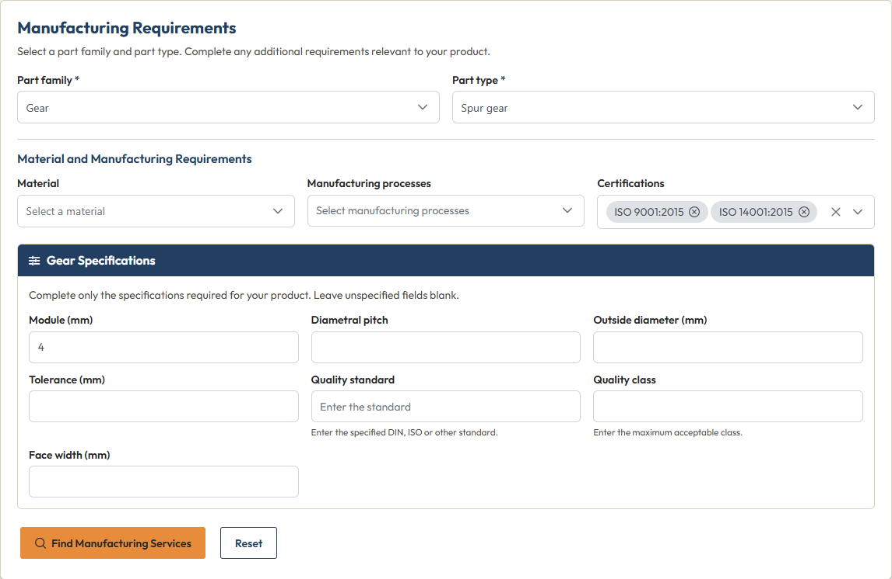

# Task 16C — Consumer multi-certification and MaaSAI button theme

- **Verified** · 27 November 2026
- **Accepted baseline** · Task 16B at `931a9c7`
- **Implementation** · `70a39d879305fe3d776423c97bf6160bcc79de90`
- **Branch** · `phase4/task16c-consumer-certifications-button-theme`
- **Status** · Verification complete. Operator visual acceptance pending.

## Consumer certification selection

The Certifications field now uses a searchable PrimeReact MultiSelect populated from the canonical `GET /api/catalog/filters` response. Each selection displays as a removable chip. The field provides a Clear all control, wraps chips at narrow widths, and retains selections when other criteria change. Reset clears the selection and restores the catalogue-derived defaults.

The existing API contract was sufficient. Search already accepts an array of canonical certification codes under `requirements.generic_requirements.certifications`. A single selection sends the existing one-code array, and an empty selection omits the field. The strict matcher requires confirmed evidence for every selected code and can use the provider certification records and applicable offering certifications. The backend stays authoritative for eligibility. [Partner API documentation](../Partner_API/MaaSAI_MDC_API_Documentation.md)

The selected codes appear together in the offering's existing Requirement Comparison. The signed-in checks also exercised the published overview, PDF export, and Contact Provider information from Task 16B. [Task 16B report](16B_MDC_Consumer_Offering_Details_and_Actions_Report.md)

## Shared MaaSAI buttons

The existing Find Manufacturing Services action established the palette at `#E78C3A`. The audit found separate outline and destructive overrides in Consumer and Admin, while some Provider variants used the underlying PrimeReact defaults.

The shared `MaaSAIButton` applies the theme to MDC action buttons across Consumer, Provider, Admin and the shared entry points. It also covers the Admin detail dialog's close control. Primary actions use the existing orange and ink, secondary actions use the navy outline in light mode and the existing brighter blue accents in Dark and HMI modes, and destructive actions use the existing red `#A82736`. The Provider table uses a red text icon on a transparent control. Admin View provider uses the same outline as Reset and secondary actions elsewhere. Styling for hover, active, focus, disabled and loading states is shared. The theme opts in at the action control so catalogue inputs, selection chips, table content and notifications use their respective component styles.

## Verification

The signed-in local app used the existing protected Preview relay. The browser exercised discovery, catalogue and detail requests within the read-only scenarios.

| Consumer scenario | Actual result |
| --- | --- |
| Spur gear without certifications | HTTP 200, with Precipart and Tasowheel Oy. The request omitted certifications. |
| ISO 9001:2015 only | The request contained `ISO9001_2015` as a one-code array and returned Tasowheel Oy. |
| ISO 9001:2015 and ISO 14001:2015 | Both canonical codes were sent. Changing Module to 4 retained both chips, and Tasowheel Oy returned with both certifications in the matched evidence. |
| Three certifications and individual removal | ISO 9001:2015, ISO 14001:2015 and APQP were submitted together. Removing ISO 14001:2015 produced a new search with just ISO 9001:2015 and APQP. |
| Missing certification | Pairing ISO 9001:2015 with Aerospace traceability, which the matching Tasowheel offering lacked, returned HTTP 200 with zero offerings. |
| Clear all, Reset and narrow layout | Clearing all omitted the field from the next request. Reset removed both chips and the Module requirement, restored the original two results on the next search, and left the form ready to submit. The chips fit within the control at a 390 px viewport. |
| Offering details and actions | Both certifications appeared in the matched comparison and exact detail reads. The browser downloaded `tasowheel_precision_gears.pdf` with a valid PDF header and end marker. Contact Provider displayed the existing informational toast without a request. |

The button checks measured computed styles for primary, outline and destructive actions in normal, hover, active and focus-visible states. Keyboard Tab moved from the search button to Reset and displayed the shared focus ring. A paused successful search demonstrated the disabled loading state and spinner. Provider and Admin lookups of the existing disposable test provider each returned HTTP 200 and a strong ETag. Provider showed the themed offering-delete icons and Admin showed the separately styled Delete provider button. Admin View provider opened its existing read-only dialog with a themed close control. The test exercised Dark and HMI accents on Consumer buttons and restored the original theme.

| Regression check | Outcome |
| --- | --- |
| Backend | 101 selected serializer, normalizer, endpoint, contract, matcher and alignment tests passed using in-memory SQLite with semantic synchronization disabled in that test process. |
| Explicit AND matrix | Four isolated cases agreed across direct matching, local RDF and the mocked Fuseki path. Both ISO requirements returned only the fixture offering with both. Either individual requirement also returned its corresponding single-certified offering. The omitted criterion returned all three. |
| Frontend | 94 passed with zero skips. This includes Consumer search, offering details and PDF, Provider registration and management, Admin, and the relay permission tests. |
| Targeted lint | Passed on every changed JavaScript file and the updated Consumer test, with zero warnings. |
| Production build | Next.js 14.0.3 built the committed frontend in isolation, generated all 20 static pages, and produced `.next/standalone/server.js`. Existing warnings concern layout Hook dependencies, a stylesheet tag in `_document.js`, and outdated Browserslist data. |

The permanent checkout retains the unrelated local edits, stashes, configuration and logo asset. One local development server is running at `127.0.0.1:3000`. The browser renders native confirmation dialogs using its own appearance. Provider and Admin verification used read-only interactions, with existing lifecycle safeguards covered by the focused regression tests.

## Screenshots

- [Certification search filter](assets/task16c-certifications-button-theme/consumer-certification-filter.png)
- [Tasowheel result with both certifications matched](assets/task16c-certifications-button-theme/consumer-two-certifications-result.png)
- [Provider action and offering-delete buttons](assets/task16c-certifications-button-theme/provider-area-buttons.png)
- [Admin primary, secondary and destructive actions](assets/task16c-certifications-button-theme/admin-area-buttons.png)

## Operator acceptance

In the local Consumer Area, select ISO 9001:2015 and ISO 14001:2015, search, then remove one chip and search again. Use Clear all and Reset to inspect the selection behavior. Open the existing disposable provider in Provider and Admin to review the orange actions, navy outlines, and separate destructive controls. [Open the local application](http://localhost:3000/demo)
